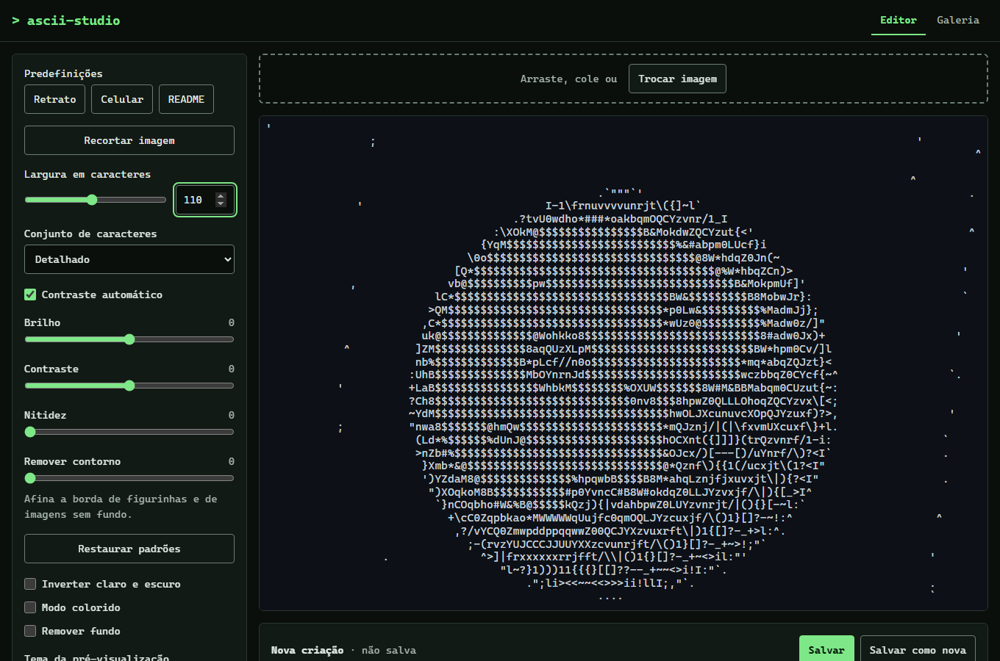
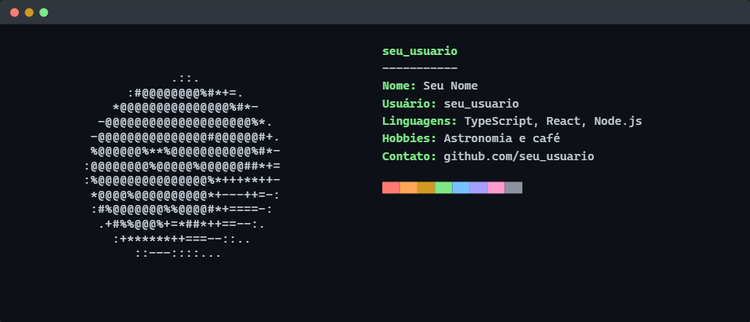
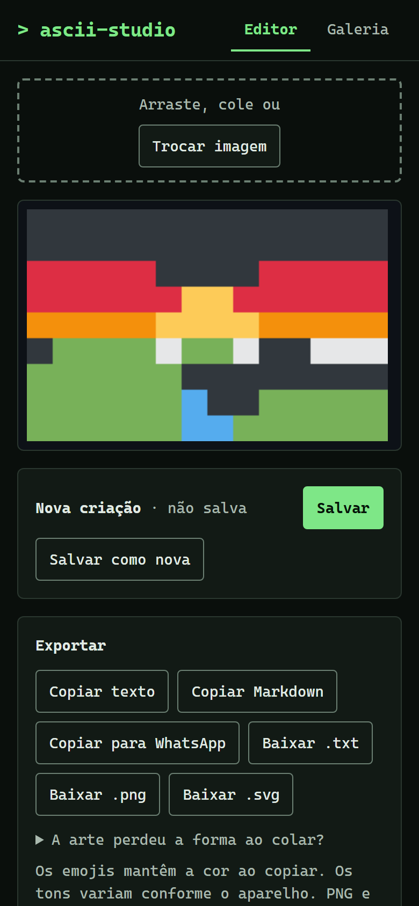
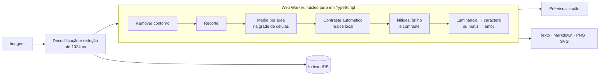

<div align="center">

# `> ascii-studio`

**Transforme imagens em ASCII art e emojis, direto no navegador.**
Para o README do seu perfil no GitHub, para o WhatsApp ou para onde quiser.

[](https://github.com/EderCostaAlvesSilva/ascii-studio/actions/workflows/ci.yml)
[](LICENSE)


[**Abrir o app →**](https://edercostaalvessilva.github.io/ascii-studio/)

</div>



```text
                     .::.
               :#@@@@@@@@%#*+=.
             *@@@@@@@@@@@@@@@%#*-
           -@@@@@@@@@@@@@@@@@@@@%*.
          -@@@@@@@@@@@@@@@#@@@@@@#+.
          %@@@@@@%**%@@@@@@@@@@@%#*-
         :@@@@@@@@%@@@@@%@@@@@@##*+=
         :%@@@@@@@@@@@@@@@%*+++**++-
          *@@@@%@@@@@@@@@@*+---++=-:
          :#%@@@@@@@%%@@@@#*+====-:
           .+#%%@@@%+=*##*++==--:.
             :+******++===--::..
                ::---::::...
```

## Por que este projeto

READMEs de perfil no GitHub costumam trazer o rosto da pessoa desenhado com caracteres, ao lado de informações no estilo `neofetch`. O ASCII Studio gera essa arte com controle fino e pré-visualização em tempo real, **sem enviar a imagem a nenhum servidor**: tudo roda no navegador.

## Destaques

- 🖼️ **Envio por arrastar, escolher ou colar** (JPG, PNG e WEBP, até 25 MB)
- ⚡ **Pré-visualização em tempo real**: a conversão roda em Web Worker e responde em cerca de 25 ms
- 🎚️ **Ajustes**: largura, conjuntos de caracteres (simples, detalhado, blocos Unicode, personalizado), brilho, contraste, nitidez, inversão, modo colorido e tema claro ou escuro
- 🪄 **Contraste automático**: realce local que revela olhos e barba mesmo ao lado de áreas muito claras
- ✂️ **Recorte e remoção de contorno**: sem alterar a imagem original e salvos com a criação
- 🧠 **Remoção de fundo no próprio navegador**, com um modelo de IA carregado só quando você ativa
- 🟧 **Modo emojis**: quadrados coloridos que mantêm a cor ao colar no WhatsApp
- 📤 **Exportação**: texto, Markdown, formato do WhatsApp, `.txt`, `.png` e `.svg`
- 🪪 **Cartão estilo neofetch** em SVG, pronto para o README
- 🗂️ **Galeria** com busca, renomear, duplicar, excluir e backup em JSON
- 🎛️ **Predefinições**: Retrato, Celular e README
- ♿ **Acessível e responsivo**: funciona só com teclado, atende WCAG AA e vai de 360 px ao desktop

| Cores | Cartão neofetch | Celular, com emojis |
|:---:|:---:|:---:|
|  |  |  |

```text
🟥🟥🟥🟥🟥🟥🟥🟥🟥🟥🟥🟥🟥🟧🟨🟨🟧🟥🟥🟥🟥🟥🟥🟥🟥🟥🟥🟥🟥🟥
🟧🟧🟧🟧🟧🟧🟧🟧🟧🟧🟧🟧🟨🟨🟨🟨🟨🟨🟧🟧🟧🟧🟧🟧🟧🟧🟧🟧🟧🟧
🟨🟨🟨🟨🟨🟨🟨🟨🟨🟧🟧🟨🟨🟨🟨🟨🟨🟨🟨🟨🟨🟨🟨🟨🟨🟨🟨🟨🟨🟨
⬛🟩🟩🟩🟩🟩🟩🟩🟩🟩🟩🟩⬛⬛⬛⬛⬛⬛⬛⬛⬛⬛⬛⬛⬛⬛⬛⬛⬛⬛
🟩🟩🟩🟩🟩🟩🟩🟩🟩🟩🟩🟩🟩🟩🟦🟦🟦🟩🟩🟩🟩🟩🟩🟩🟩🟩🟩🟩🟩🟩
```

## Como funciona



**Decisões que valem destacar:**

- **Núcleo puro, separado da interface.** Toda a conversão e a exportação ficam em `src/core`, sem React nem DOM, trabalhando sobre buffers RGBA. Por isso roda num Worker, é determinística e tem cobertura de testes unitários.
- **"Último pedido vence".** O Worker tem no máximo um pedido em execução e um na fila; ajustes rápidos descartam cálculos obsoletos em vez de acumulá-los, então a interface nunca trava.
- **Célula em proporção 1:2.** Caracteres são mais altos que largos, e a grade corrige isso. PNG e SVG desenham célula a célula e representam blocos Unicode e emojis como retângulos, para o resultado não depender das fontes do sistema.
- **Reabrir gera a mesma arte.** A imagem de trabalho é salva em PNG, sem perdas, e a sessão já trabalha com a versão salva, então uma criação reaberta é idêntica à original.
- **Ajustes não destrutivos.** Recorte e remoção de contorno são configurações aplicadas na conversão: a imagem original nunca muda.
- **Emojis por matiz, e não por distância de cor.** Com só 9 cores disponíveis, a distância simples levaria azul puro a ⬛ e pele a 🟥.
- **Funciona sem recursos modernos.** Onde não há `OffscreenCanvas`, o app usa um canvas comum, e a cópia tem um método alternativo fora de HTTPS.

## Privacidade

- **Imagens:** nenhuma imagem ou dado pessoal sai do dispositivo. Não há back-end, nem telemetria, nem analytics, e um teste automatizado falha se algum fluxo fizer requisição que não seja GET para a própria origem.
- **Remoção de fundo:** o único acesso externo é o download do modelo de IA (cerca de 54 MB, do CDN da IMG.LY), feito só depois de você confirmar e guardado em cache pelo navegador.
- **Galeria:** fica no armazenamento do navegador. Limpar os dados do site apaga a galeria, então use **Exportar backup** para guardar uma cópia.

## Rodando localmente

Requer **Node 20.19** ou mais recente.

```bash
npm install
npm run dev          # http://localhost:5173
```

### Com Docker

```bash
docker compose up --build    # http://localhost:8080
```

A imagem usa build em duas etapas: o Node só gera o site, e quem serve é um nginx com gzip, cache imutável dos arquivos com hash e cabeçalhos de segurança.

### Scripts

| Comando | O que faz |
|---|---|
| `npm run dev` | Servidor de desenvolvimento |
| `npm run build` | Checagem de tipos e build de produção em `dist/` |
| `npm run typecheck` | Só a checagem de tipos |
| `npm test` | Testes unitários (Vitest) |
| `npm run test:e2e` | Testes de ponta a ponta (Playwright: Chromium, Firefox, WebKit e tela de celular) |
| `npm run test:e2e:network` | Teste real da remoção de fundo, que baixa o modelo |

Na primeira vez, instale os navegadores dos testes com `npx playwright install`.

## Qualidade

- **TypeScript** em modo estrito, sem `any`.
- **171 testes unitários** cobrindo conversão, exportação, backup, galeria e compatibilidade com criações antigas.
- **Testes de ponta a ponta** dos fluxos principais em Chromium, Firefox e WebKit, incluindo celular de 360 px.
- **Acessibilidade** verificada com axe (WCAG 2.1 AA) e um fluxo completo feito só com teclado.
- **Desempenho medido**: cerca de 25 ms entre um ajuste e a nova pré-visualização, numa imagem de 1024 px com 120 colunas, contra uma meta de 200 ms.
- **Regressão visual do SVG**: o teste desenha o arquivo exportado e mede onde os caracteres aparecem.

A CI no GitHub Actions roda tipos, testes unitários, ponta a ponta e build a cada push, e publica no GitHub Pages quando a branch `main` passa.

## Estrutura

```text
src/
├── core/       Conversão e exportação: funções puras, sem React nem DOM
├── storage/    Galeria em IndexedDB (Dexie) e backup em JSON
├── workers/    Web Workers da conversão e da remoção de fundo
└── ui/         Componentes React e integração com o navegador
tests/
├── unit/       Vitest
├── e2e/        Playwright
└── fixtures/   Imagens de teste
```

## Stack

| | |
|---|---|
| Interface | React 19, Tailwind CSS 4 |
| Linguagem e build | TypeScript (estrito), Vite |
| Processamento | Canvas API e Web Workers |
| Remoção de fundo | [`@imgly/background-removal`](https://github.com/imgly/background-removal-js) (ONNX Runtime Web) |
| Armazenamento | IndexedDB, via Dexie |
| Testes | Vitest, Playwright, axe-core |
| Entrega | GitHub Actions, GitHub Pages, Docker com nginx |

## Licença

Distribuído sob a **GNU AGPL-3.0**; veja [LICENSE](LICENSE). A licença acompanha a da biblioteca de remoção de fundo, `@imgly/background-removal`, que também é AGPL-3.0.

A rampa de 70 caracteres do conjunto "Detalhado" é a clássica de Paul Bourke. As imagens de demonstração em `docs/` são sintéticas, geradas para este README.

---

Feito por **[Eder Costa Alves Silva](https://github.com/EderCostaAlvesSilva)**.
